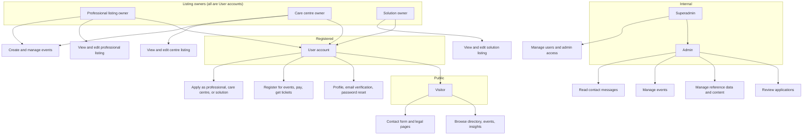
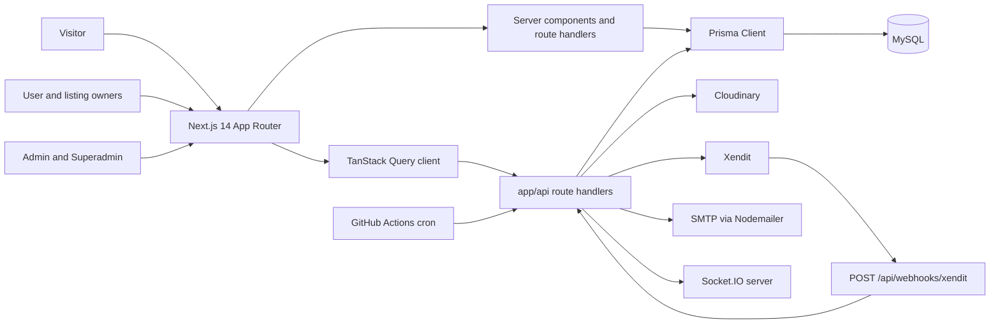
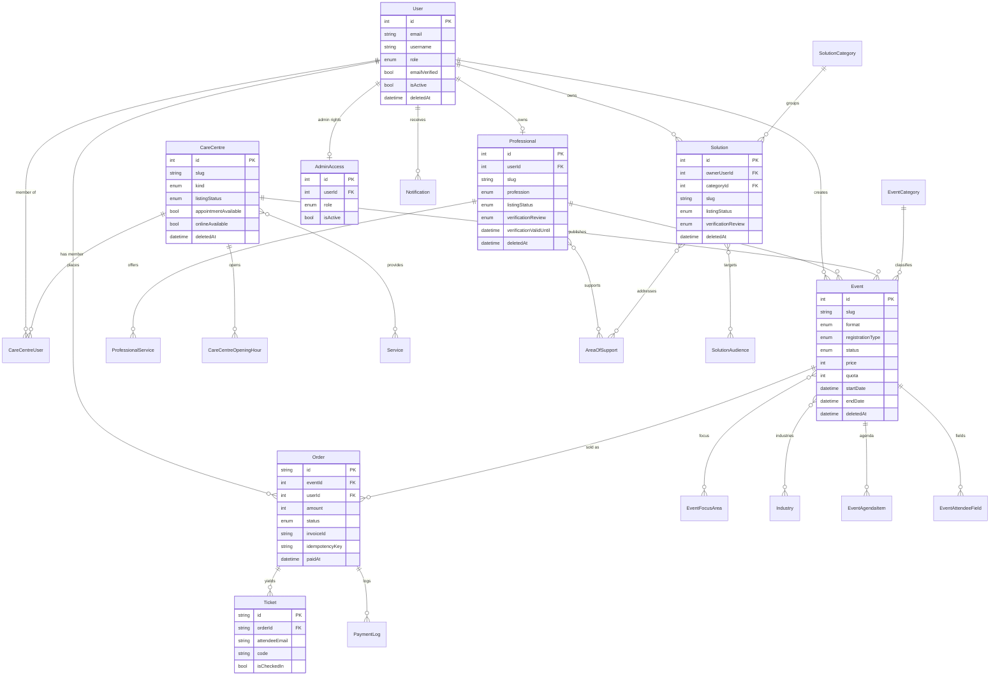
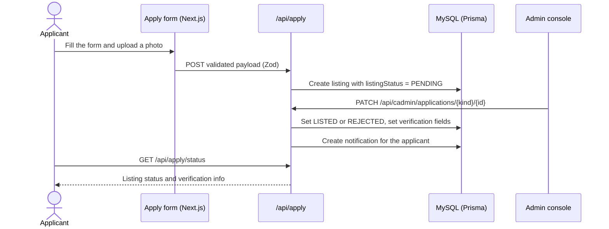
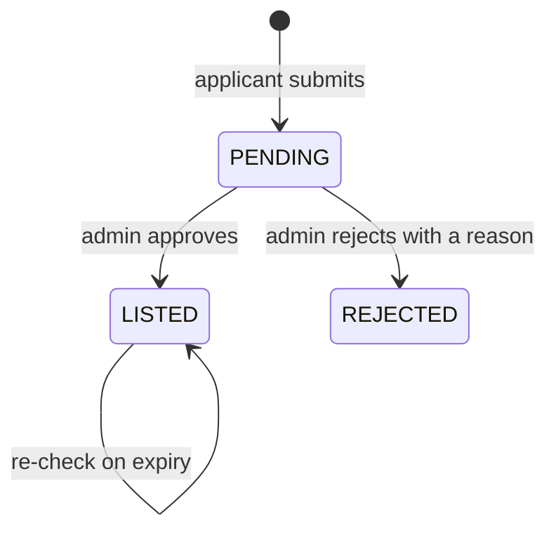
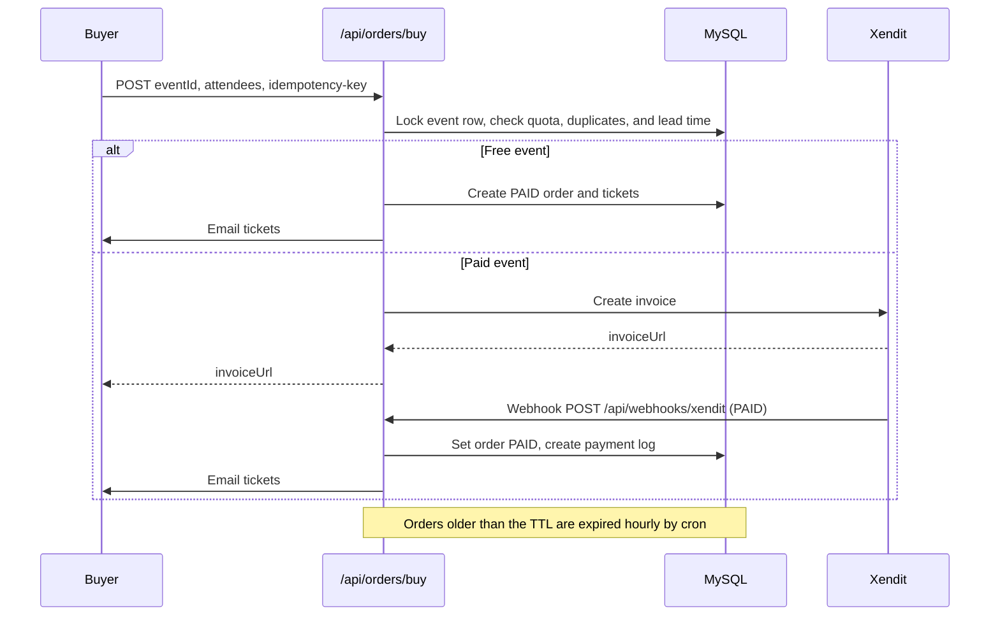

# MindCare.id

Web platform for mental-health services in Indonesia. It combines a public directory (professionals, care centres, and solutions), an events and ticketing system with online payment, user dashboards for listing owners, and an internal admin console that reviews every directory listing before it goes live.

This document is the project reference: what is built, what each actor can do, how the data is modelled, how the main flows work, and what is still missing.

---

## Documentation status

Before this file, the repository had no product documentation. The only `README.md` was the default `create-next-app` text, there was no `docs/` folder, and there was no `.env.example`. Decisions lived in the code and in commit messages.

This README is now the single reference. It documents the areas that exist in code, with the status of each.

`docs/` holds narrower documents:

| File | Contents |
|---|---|
| `docs/hero-carousel.md` | How the homepage hero slideshow works, how to manage it from the admin console, and its image and motion rules |
| `docs/changelog.md` | Dated record of changes made outside the product's own feature work, with the files touched |

### How much is covered

Measured from the repository at the time of writing:

| Artifact | Count | Documented here |
|---|---|---|
| Prisma models | 39 | Yes (ERD for the core, full list in `prisma/schema.prisma`) |
| Prisma enums | 31 | Partly (the ones that drive behaviour) |
| API route handlers (`app/api/**/route.ts`) | 70 | Grouped by area |
| Pages (`app/**/page.tsx`) | 85 | Grouped by area |
| TSX files under `app/` (pages and components) | 288 | Summarised |
| Library modules (`lib/**/*.ts`, `.tsx`) | 98 | Summarised |

There is still no separate PRD, no BRD, and no written product spec. This README describes what the code does today, which is not the same as a forward plan.

---

## Stack

| Layer | Choice |
|---|---|
| Framework | Next.js 14 (App Router), React 18, TypeScript |
| Styling | Tailwind CSS v4 |
| Database | MySQL via Prisma 6 (`relationMode = "prisma"`, so referential integrity is enforced by the app, not the database) |
| Auth | NextAuth v4, JWT sessions (credentials, Google, GitHub) |
| Data fetching | TanStack Query (client), server components (server) |
| Forms and validation | react-hook-form + Zod |
| Media | Cloudinary (signed upload, stored by `publicId`) |
| Payments | Xendit invoices + webhook |
| Email | Nodemailer over SMTP (templated HTML for verification, reset, listing review, tickets, contact) |
| PDF and export | `@react-pdf/renderer` (tickets, receipts), `exceljs`, `jspdf`, `html2canvas` |
| Realtime | Socket.IO client |
| Icons | Font Awesome, Lucide, react-icons |

---

## Actors and what they can do

The account table has one role field (`UserRole`: `SUPERADMIN`, `ADMIN`, `USER`, `INSTITUTION`). Admin rights do **not** come from that field at decision time: they are read from the `AdminAccess` table through `resolveAdminRole` (`lib/adminAccess.ts`). A `User.role` of `ADMIN` grants nothing once an `AdminAccess` row exists and is inactive. The `INSTITUTION` value is present in the enum but is not used anywhere in the app.

The listing types (professional, care centre, solution) are not separate account roles. Each is a record owned by, or linked to, a normal `USER` account.

### Capability matrix

| Capability | Visitor | User | Professional owner | Care centre owner | Solution owner | Admin | Superadmin |
|---|---|---|---|---|---|---|---|
| Browse directory (professionals, centres, solutions) | Yes | Yes | Yes | Yes | Yes | Yes | Yes |
| Browse events and insights | Yes | Yes | Yes | Yes | Yes | Yes | Yes |
| Contact form, report a concern, legal pages | Yes | Yes | Yes | Yes | Yes | Yes | Yes |
| Register and sign in (email, Google, GitHub) | No | Yes | Yes | Yes | Yes | Yes | Yes |
| Verify email, reset password, edit profile, upload avatar | No | Yes | Yes | Yes | Yes | Yes | Yes |
| Register or buy event tickets (paid or free) | No | Yes | Yes | Yes | Yes | Yes | Yes |
| View own orders, tickets, notifications | No | Yes | Yes | Yes | Yes | Yes | Yes |
| Apply as professional / care centre / solution | No | Yes | Yes | Yes | Yes | Yes | Yes |
| View own listing and verification status | No | No | Yes | Yes | Yes | Yes | Yes |
| Edit own listing | No | No | Yes | Yes | Yes | Yes | Yes |
| Create and manage events | No | No | Yes (listing must be `LISTED`) | Yes (membership `ACTIVE`, centre `LISTED`) | No | Yes | Yes |
| Review applications (approve / reject, set validity) | No | No | No | No | No | Yes | Yes |
| Manage users and admin access | No | No | No | No | No | No | Yes |
| Manage reference data (taxonomy) | No | No | No | No | No | Yes | Yes |
| Manage events, content (hero, why us, about, articles) | No | No | No | No | No | Yes | Yes |
| Read contact messages | No | No | No | No | No | Yes | Yes |

Notes that matter when reading the matrix:

- Event creation is allowed only for a professional listing with `listingStatus = LISTED` or a care centre the user belongs to with `status = ACTIVE` (`app/api/listing/events/route.ts`). Solution owners cannot create events; `canCreateEvents` is `professional || careCentre` in `useMyListings.ts`.
- Editing identity fields on an already-reviewed listing is guarded. The screen text says editing after review is not available, and identity fields (name, licence, permit, location) are treated as fixed inputs.

### Actor map



---

## Feature status

| Area | Status | Notes |
|---|---|---|
| Auth and accounts | Built | Email/password, Google, GitHub, email verification, resend, forgot and reset password, change password, profile edit, avatar upload |
| Public: Professionals | Built (database) | List, detail, filters, facets, sorting; only approved rows are shown |
| Public: Care centres | Built (database) | List, detail, opening hours, services, location |
| Public: Solutions | Built (database) | List, detail, categories, audiences, focus areas |
| Public: Events | Built (database) | List, detail, filters, internal and external registration, agenda, attendee fields |
| Public: Insights | Static (reserved) | Renders seed data from `app/(user)/insights/data/articles.ts`; the authoring workflow is not decided yet |
| Public: Home hero slideshow | Built | Admin-managed images with an optional per-slide title, description and button; falls back to the default hero when no slide is active. See `docs/hero-carousel.md` |
| Applications | Built | Separate forms for professional, care centre, and solution, Zod validated, Cloudinary photo handling, status page |
| Admin console | Built | Applications triage, users and admin access, reference data, events and attendee fields, content, contact messages |
| Event ticketing | Built | Free and paid flows, Xendit invoices, webhook, quota checks, idempotency keys, duplicate-email guard |
| Tickets | Built | Unique code, QR code, PDF, email delivery |
| Order expiry | Built | GitHub Actions cron calls `/api/transaction/expire` hourly |
| Notifications | Built | Stored in the database, pushed over Socket.IO |
| Listings self-edit after review | Not available | Editing reviewed identity fields is blocked by design |
| Company and institution | Removed or legacy | Company routes were removed; `Company` and `CompanyUser` remain in the schema; `UserRole.INSTITUTION` is unused |

---

## Architecture



Directory map:

| Path | Contents |
|---|---|
| `app/(user)` | Public site: home, professionals, care-centres, solutions, events, insights, help |
| `app/auth` | Sign in, register, forgot and reset password |
| `app/apply` | Application forms for professional, care centre, and solution |
| `app/dashboard` | User dashboard: orders, tickets, professional, care centre, solution, events |
| `app/cadmin` | Admin console |
| `app/api` | Route handlers (auth, applications, admin, events, orders, tickets, webhooks, uploads) |
| `lib` | Prisma client, auth, guards, mail, PDF, Cloudinary, orders, events, validations |
| `prisma` | Schema and migrations |
| `docs` | Focused documents: hero slideshow, changelog |
| `.github/workflows` | Order expiry cron |

---

## Data model

39 models, 31 enums. `prisma/schema.prisma` holds the complete definition. The diagram below covers the entities that carry the product behaviour.



Key modelling points:

- Most entities use soft delete (`deletedAt`) instead of hard delete.
- Listings share a `ListingStatus` lifecycle and a `VerificationReview` status with expiry fields (`verificationCheckedOn`, `verificationValidUntil`, `verificationSource`, `verificationNote`).
- Verification evidence is kept private (`verificationAdminId`, licence and permit numbers) and not shown on public pages.
- `Media` is a shared attachment table keyed by optional `companyId`, `solutionId`, `careCentreId`, `professionalId`.

---

## Main flows

### Directory application and review



### Listing lifecycle



### Event ticket purchase



Purchase correctness details worth knowing:

- The buyer must have `emailVerified = true`.
- A per-user rate limit of 10 purchase attempts per minute applies, and the webhook is rate limited by client IP.
- `idempotencyKey` is unique; a replay returns the existing order rather than creating a second one.
- Quota is checked inside a serializable transaction that locks the event row.
- The webhook verifies the Xendit callback token with a constant-time comparison and rejects amount or currency mismatches.

---

## Notifications and email

- Notifications are rows in `Notification`, filtered by type (`COMPANY_INVITE`, `COMPANY_ACCEPTED`, `COMPANY_DECLINED`, `GENERAL`), with unread counts and a read-all endpoint. The client subscribes over Socket.IO using `NEXT_PUBLIC_SOCKET_URL`.
- Transactional email is template based under `lib/mail`. There are senders for verification, password reset, listing review, tickets, and contact. HTML is escaped through `lib/mail/escape.ts`.

---

## Getting started

### Requirements

- Node.js 20 or later
- MySQL
- A Cloudinary account (media uploads)
- A Xendit account (event payments)
- An SMTP mailbox (verification and ticket email)

### Install and run

```bash
npm install

# Generate the Prisma client and apply migrations to your database
npx prisma generate
npx prisma migrate deploy

npm run dev
```

The app runs at `http://localhost:3000`.

### Scripts

| Command | What it does |
|---|---|
| `npm run dev` | Start the dev server on `0.0.0.0` |
| `npm run build` | `prisma generate && prisma migrate deploy && next build` |
| `npm run start` | Start the production server |
| `npm run lint` | Run ESLint |

Note that `npm run build` applies pending migrations. A production build therefore writes to the database schema. Run it against the intended database only.

### Environment variables

Create a `.env` file. There is no committed `.env.example`, so this list is the reference.

Core:

| Variable | Purpose |
|---|---|
| `DATABASE_URL` | MySQL connection string (used by Prisma) |
| `NEXTAUTH_SECRET` | NextAuth signing secret |
| `NEXTAUTH_URL` | Public base URL of the app |
| `NEXT_PUBLIC_BASE_URL` | Base URL used by server side fetches |

Auth providers:

| Variable | Purpose |
|---|---|
| `GOOGLE_CLIENT_ID`, `GOOGLE_CLIENT_SECRET` | Google sign in |
| `GITHUB_ID`, `GITHUB_SECRET` | GitHub sign in |

Cloudinary:

| Variable | Purpose |
|---|---|
| `NEXT_PUBLIC_CLOUDINARY_CLOUD_NAME` | Cloud name (client and server) |
| `CLOUDINARY_API_KEY`, `CLOUDINARY_API_SECRET` | Signed uploads and deletes |
| `CLOUDINARY_UPLOAD_PRESET`, `NEXT_PUBLIC_CLOUDINARY_UPLOAD_PRESET` | Upload preset |

Email:

| Variable | Purpose |
|---|---|
| `SMTP_HOST`, `SMTP_PORT`, `SMTP_SECURE`, `SMTP_USER`, `SMTP_PASS` | SMTP transport |
| `CONTACT_FORWARD`, `CONTACT_FORWARDEMAIL` | Contact form forwarding |

Payments and orders:

| Variable | Purpose |
|---|---|
| `XENDIT_SECRET_KEY` | Xendit API key |
| `XENDIT_WEBHOOK_TOKEN` | Verified on the webhook callback |
| `XENDIT_FOR_USER_ID` | Xendit account scoping |
| `MAX_TICKETS_PER_ORDER` | Attendee cap per order (default 10) |
| `ORDER_PENDING_TTL_MINUTES` | Pending order lifetime before expiry (default 30) |
| `ORDER_EXPIRE_BATCH_SIZE` | Batch size for the expiry job (default 50) |

Cron and realtime:

| Variable | Purpose |
|---|---|
| `CRON_SECRET` | Bearer token expected by `/api/transaction/expire` |
| `APP_BASE_URL` | GitHub Actions secret for the cron workflow target |
| `NEXT_PUBLIC_SOCKET_URL` | Socket.IO endpoint used by the client |
| `SOCKET_SERVER_URL`, `SOCKET_INTERNAL_SECRET` | Server side socket use |

`lib/socket.ts` reads `NEXT_PUBLIC_SOCKET_URL` at import time, so a missing value breaks socket features at module load.

---

## Verification and testing

There is no automated test suite and no `test` script. The available checks are:

- `npm run lint` for static checks.
- Ad-hoc scripts under `scripts/`: `check-data-invariants.mjs`, `check-photo-behavior.cjs`, `check-photo-upload.mjs`, `check-tailwind-classes.mjs`, plus `test-events.cjs` at the repository root.
- Manual click-through of the listed flows.

If a test framework is added later, wire it into a `test` script so it can be run in one command.

---

## Known gaps

These are present in the repository as-is and are worth a decision:

- `Insights` renders static seed data. Its authoring workflow is not decided yet, so the content is not managed from the admin console.
- `Company` and `CompanyUser` remain in the schema together with company references in the auth token, even though the company feature was removed. `UserRole.INSTITUTION` is unused.
- Editing a listing's identity fields after review is blocked; the UI points users to contact support instead.
- `middleware.ts` matches paths such as `/my-classes` and `/order` that no longer have pages.
- `next.config.js` allows remote images only from Cloudinary, GitHub avatars, and jsDelivr. Any new image host must be added there.
- Deployment applies migrations during `npm run build`.
- Roughly 240 source lines contain double-encoded UTF-8, which renders as garbage in the browser (for example a mangled em dash or copyright sign). Three files were repaired by hand; the rest await a file-by-file pass with a UTF-8 safe editor. See `docs/changelog.md`.
- The public site mixes English and Indonesian. Home, navigation, and footer are English; the Help Centre pages and summaries are Indonesian, sometimes within the same page.
- `/help/report-concern`, `/help/disclaimer`, and `/help/terms-of-service` are placeholders that render "not published yet". The site therefore has no staffed reporting channel yet, and the homepage does not link to one.
- The homepage `h1` is the active hero slide's title when that slide has one, so it changes as the slideshow advances. Slide titles read "promo" or "faq" produce a weak `h1` for search.
- `EventsCardGrid` accepts a `now` prop that the component never uses; the prop is still passed by five callers.
- `app/(user)/section/` holds unused components from another product (Execorner), including hardcoded statistics and `/images/HRDI.jpg`. Nothing imports them. See `docs/changelog.md`.
